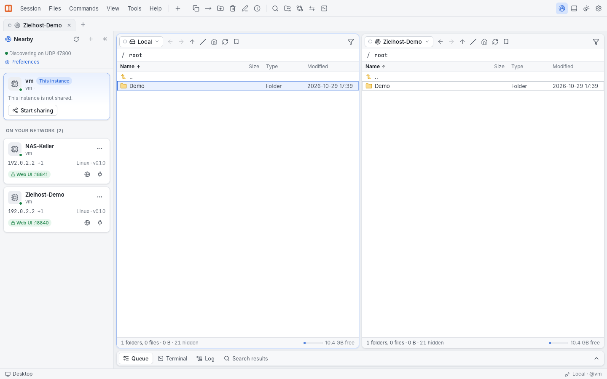
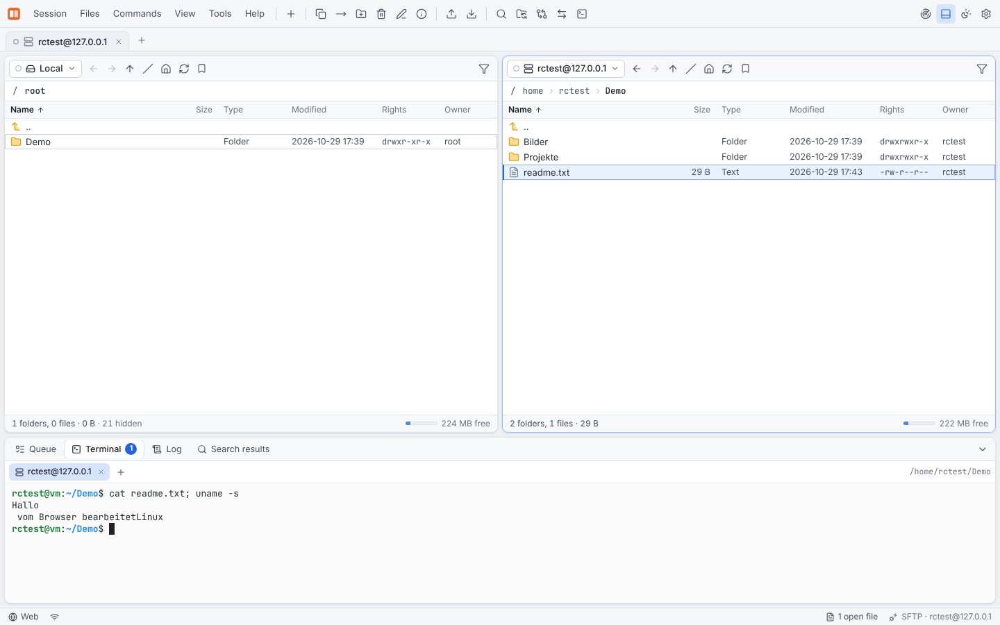
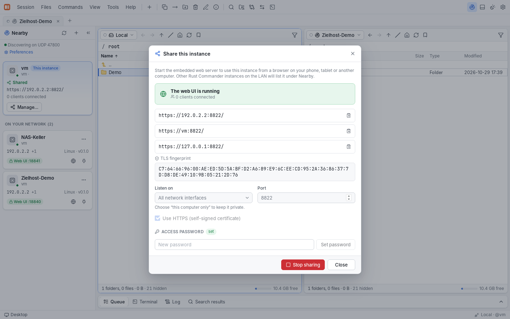
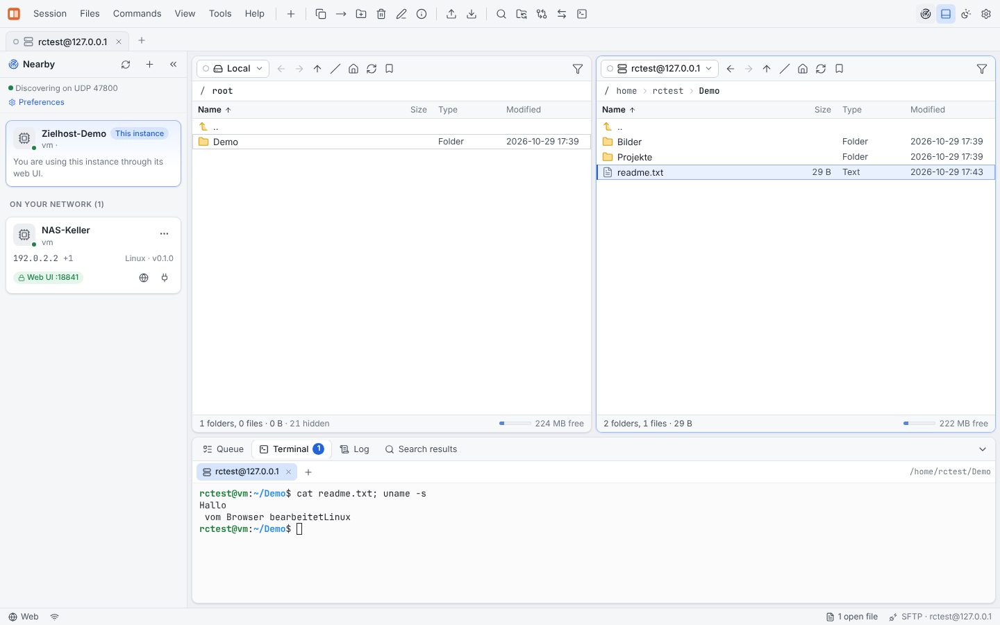

# Rust Commander

Ein Zwei-Fenster-Dateimanager und Transfer-Client im Stil von [WinSCP](https://github.com/winscp/winscp), komplett neu in **Rust** geschrieben, mit einer **Tauri**-Oberfläche. Rust Commander läuft als Desktop-App (Windows, macOS, Linux) und zusätzlich **headless auf einem Zielhost**. Dort stellt er dieselbe Oberfläche im Browser bereit. Laufende Instanzen **finden sich gegenseitig im LAN** und lassen sich direkt aus der App heraus öffnen.

| Desktop: andere Instanz als Panel eingebunden | Web: SFTP-Sitzung mit Terminal auf dem Zielhost |
|---|---|
|  |  |
| **Desktop: „Diese Instanz freigeben“** | **Web: Instanzen in der Nähe (LAN-Discovery)** |
|  |  |

## Funktionen

### WinSCP-Funktionsumfang

| Bereich | Rust Commander |
|---|---|
| Protokolle | **SFTP**, **SCP**, **FTP**, **FTPS** (explizit/implizit), **WebDAV(S)**, **Amazon S3** und S3-kompatible Speicher (MinIO, Wasabi, R2, Ceph …) |
| Oberfläche | Commander-Ansicht mit zwei Panels, Lesezeichen, synchronisiertes Browsen, Verzeichnisvergleich, Tastaturbedienung (F2–F8, Ins, Strg+…) |
| Anmeldung | Passwort, Public Key (OpenSSH/PEM, verschlüsselt), SSH-Agent/Pageant, Keyboard-Interactive (2FA/OTP), Jump-Host (ProxyJump), SOCKS5/HTTP-Proxy, eigener SFTP-Server-Befehl (z. B. `sudo /usr/lib/openssh/sftp-server`) |
| Sicherheit | Host-Key-Prüfung mit TOFU und Warnung bei geänderten Schlüsseln, Abgleich mit `~/.ssh/known_hosts`, TLS-Zertifikatsprüfung |
| Seitenverwaltung | Ordner, Farben, Notizen, Import aus **WinSCP.ini**, **FileZilla** (`sitemanager.xml`), **`~/.ssh/config`**, JSON-Export, URLs (`sftp://user@host:22/pfad`) |
| Übertragungen | Hintergrund-Warteschlange mit Pause/Fortsetzen/Abbrechen/Wiederholen, Fortsetzen abgebrochener Übertragungen, Überschreib-Nachfrage (Überschreiben/Überspringen/Fortsetzen/Umbenennen/Nur neuere), Zeitstempel und Rechte erhalten, Text-/Binärmodus, Dateimasken (`*.txt; *.log \| tmp/; >10M; <7D`), Geschwindigkeitslimit, Upload über temporäre Datei, Verschieben |
| Synchronisation | Vergleichen in eine Richtung oder in beide (Größe/Zeit/Prüfsumme), Spiegeln, verwaiste Dateien löschen, **Checkliste** vor dem Ausführen, „Remote-Verzeichnis aktuell halten“ (Dateisystem-Überwachung) |
| Dateioperationen | Umbenennen, Löschen (rekursiv als Job), Ordner/Datei anlegen, symbolische Links, Eigenschaften (chmod rekursiv, getrennte Ordnerrechte, chown, Änderungsdatum), Ordnergröße, Prüfsummen (MD5/SHA-1/SHA-256) |
| Editor | Integrierter Editor mit Syntaxhervorhebung; Bearbeiten mit externer Anwendung, die Datei wird beim Speichern automatisch hochgeladen |
| Weitere | Dateien suchen (Name, Größe, Datum, Inhalt), benutzerdefinierte Befehle (`!`, `!&`, `!/`, `!@`, `!U`), Befehle auf dem Server ausführen, Sitzungsinformationen, Protokoll-Panel |
| Scripting | `rcmd script`: WinSCP-artige Befehle (`open`, `ls`, `cd`, `get`, `put`, `synchronize`, `keepuptodate`, `chmod`, `checksum` …) |

### Zusätzlich zu WinSCP

- **Webmodus auf dem Zielhost** – `rcmd serve` startet Rust Commander ohne GUI auf einem Server. Vom Quellhost aus öffnet man `https://zielhost:8822/` im Browser und bekommt die komplette Oberfläche mit dem Dateisystem des Zielhosts. Von dort aus kann man auch zu weiteren Servern verbinden. Uploads und Downloads laufen direkt zwischen Browser und Zielhost (Ordner werden als ZIP gestreamt).
- **LAN-Discovery** – Instanzen kündigen sich per UDP-Broadcast und Multicast an (Port 47800) und erscheinen in der Seitenleiste **„In der Nähe“**. Die Weboberfläche lässt sich dort per Klick öffnen, oder man bindet die andere Instanz **als Dateipanel** ein (Protokoll `rcmd`, TLS mit Fingerprint-Pinning). Instanzen in anderen Netzen kann man über ihre Adresse hinzufügen.
- **Diese Instanz freigeben** – Die Desktop-App kann ihre eigene Oberfläche ebenfalls im Netz anbieten (Passwort, HTTPS).
- **Integriertes Terminal** – SSH-Shell und lokale Shell in Tabs (xterm.js). WinSCP braucht dafür PuTTY.
- **Port-Weiterleitung** – Lokale Weiterleitung (`-L`) und dynamischer SOCKS5-Proxy (`-D`) über SSH-Sitzungen.
- **Cloud-Speicher** – Azure Blob Storage und Google Cloud Storage zusätzlich zu S3.
- **Server-zu-Server-Kopien** – Beide Panels können beliebige Sitzungen zeigen, z. B. SFTP → S3 oder FTP → SFTP, ohne Umweg über die lokale Platte.
- **Archive** – ZIP, TAR und TAR.GZ lokal erstellen und entpacken.
- **Prüfsummen-Verifikation** nach jeder Übertragung (optional), **parallele Übertragungen** innerhalb eines Jobs.
- **Tresor mit Master-Passwort** – Gespeicherte Passwörter und Schlüssel werden mit XChaCha20-Poly1305 verschlüsselt (Schlüssel per Argon2id aus dem Master-Passwort abgeleitet).
- Helles und dunkles Design, Deutsch und Englisch, angepasste Ansicht für schmale Bildschirme (Webmodus auf dem Handy).

## Architektur

```
crates/
  rc-core        Dateisystem-Abstraktion (Vfs) + Protokolle, Transfer-Warteschlange,
                 Synchronisation, Suche, Tresor, Seitenspeicher, Importe, Tunnel, Archive
  rc-discovery   LAN-Discovery über UDP-Broadcast und Multicast
  rc-api         Anwendungszustand + RPC-Dispatcher (eine API für Desktop und Web)
  rc-server      HTTP(S)-Server: eingebettete UI, /api/rpc, WebSocket-Events,
                 Up-/Download, Login, selbstsigniertes TLS-Zertifikat
  rc-cli         rcmd: serve, discover, script, set-password, sites
src-tauri/       Desktop-App (Tauri 2): Befehl `rpc` + Event `rc-event`
ui/              Oberfläche (React + TypeScript + Vite), identisch für Desktop und Web
```

Die gesamte Logik liegt in Rust. Die Oberfläche spricht immer dieselbe API (`ui/src/api/types.ts`): In der Desktop-App per Tauri-`invoke`, im Browser per `POST /api/rpc` und einem WebSocket für Ereignisse. Deshalb sind Desktop- und Webmodus funktional gleich.

## Bauen

Voraussetzungen: Rust (stable), Node.js ≥ 20. Unter Linux zusätzlich die [Tauri-Abhängigkeiten](https://tauri.app/start/prerequisites/) (`libwebkit2gtk-4.1-dev`, `librsvg2-dev`, `libayatana-appindicator3-dev`, `libxdo-dev`).

```bash
# Oberfläche
npm --prefix ui ci
npm --prefix ui run build

# Desktop-App (Entwicklung / Installationspakete)
npm ci
npm run dev          # tauri dev
npm run build        # tauri build -> src-tauri/target/release/bundle/

# Headless-Server + CLI (ohne GUI-Abhängigkeiten)
cargo build --release -p rc-cli     # -> target/release/rcmd
```

## Benutzung

### Desktop

`rust-commander` starten. Mit **Strg+N** öffnet sich die Seitenverwaltung. Links liegt standardmäßig das lokale Dateisystem, rechts der Server. Weitere Funktionen findet man in den Menüs und Kontextmenüs. Die Tastenkürzel entsprechen WinSCP/Norton Commander (F5 Kopieren, F6 Verschieben, F7 Ordner, F8 Löschen …).

### Auf einem Zielhost im Webmodus

```bash
rcmd set-password                 # einmalig ein Login-Passwort speichern
rcmd serve                        # https://<host>:8822/  (selbstsigniertes Zertifikat)
rcmd serve --port 9000 --no-tls   # nur in vertrauenswürdigen Netzen
rcmd serve --no-terminal          # keine Shell/Befehle für Web-Benutzer
```

Ohne gespeichertes Passwort erzeugt `rcmd serve` ein Einmal-Passwort und gibt es zusammen mit den URLs und dem TLS-Fingerprint aus. Den Fingerprint vergleicht man beim ersten Aufruf im Browser. Dauerbetrieb: `packaging/rust-commander.service` (systemd) oder das `Dockerfile`.

### Instanzen im Netz finden

```bash
rcmd discover          # listet alle Instanzen im LAN
```

In der App zeigt die Seitenleiste **„In der Nähe“** (Strg+B) dieselbe Liste live an, mit den Aktionen *Weboberfläche öffnen*, *Als Panel verbinden* und *Als Seite speichern*. Discovery lässt sich in den Einstellungen abschalten oder auf einen anderen Port legen. Ankündigungen sind nur Hinweise. Zugriff gibt es immer erst nach dem Login, und das Zertifikat wird gepinnt.

### Scripting

```bash
rcmd script -c "open sftp://user@example.com -hostkey=*" -c "lcd /backup" -c "get /var/log/*.log" -c "exit"
rcmd script deploy.txt
rcmd script            # interaktive Konsole
```

```text
# deploy.txt
open "Produktion/Webserver"          # gespeicherte Seite
synchronize remote ./dist /var/www/html -delete -criteria=checksum
call systemctl reload nginx
exit
```

## Tests

```bash
cargo test --workspace
```

Die Protokoll-Integrationstests laufen nur mit echten Servern und werden über Umgebungsvariablen aktiviert:

- SSH: `RC_TEST_SSH_HOST`, `RC_TEST_SSH_PORT`, `RC_TEST_SSH_USER`, `RC_TEST_SSH_PASSWORD`, `RC_TEST_SSH_KEY`
- FTP/Cloud: `RC_TEST_FTP_URL`, `RC_TEST_FTPES_URL`, `RC_TEST_FTPS_URL`, `RC_TEST_WEBDAV_URL`, `RC_TEST_S3_ENDPOINT`, `RC_TEST_AZURE_ENDPOINT` … Die passenden Testserver (Python-Skripte) liegen in `crates/rc-core/tests/servers/`. Eine Anleitung steht in den Kopfkommentaren von `crates/rc-core/tests/ftp.rs` und `cloud.rs`.

Die Oberfläche lässt sich ohne Backend mit Testdaten ausprobieren: `npm --prefix ui run dev` und dann `http://localhost:5173/?mock=1` öffnen. Der Playwright-Smoke-Test der Oberfläche läuft mit `npm --prefix ui test`.

## Bekannte Einschränkungen

- **Google Cloud Storage** ist implementiert, aber nicht gegen einen echten Dienst getestet (alle anderen Protokolle sind mit echten Servern getestet: OpenSSH, pyftpdlib mit FTPS, WsgiDAV, S3-API von moto, Azurite).
- Object Stores (S3/Azure/GCS) können abgebrochene **Uploads** nicht fortsetzen und keine Zeitstempel oder Rechte setzen. Downloads lassen sich fortsetzen.
- WebDAV unterstützt nur Basic-Authentifizierung. SSH-Host-Zertifikate (CA) und vom Server erzwungene Passwortänderungen werden nicht unterstützt.
- Dateinamen, die kein gültiges UTF-8 sind, werden bei SFTP verlustbehaftet dargestellt.
- Die Windows- und macOS-Builds sind per Cross-Compile geprüft und über die CI abgedeckt, aber nicht manuell auf diesen Systemen getestet.

## Sicherheitshinweise

- Der Webmodus gewährt Zugriff auf das Dateisystem des Hosts mit den Rechten des Benutzers, unter dem `rcmd` läuft, standardmäßig auch auf eine Shell (`--no-terminal` schaltet das ab). Verwende ein starkes Passwort und HTTPS.
- Anmeldungen sind gegen Brute-Force gedrosselt. Sitzungen nutzen HttpOnly-/SameSite-Cookies, und alle schreibenden Anfragen sind gegen CSRF geschützt.
- Gespeicherte Geheimnisse sind immer verschlüsselt. Ohne Master-Passwort liegt der Schlüssel in `vault.key` im Konfigurationsverzeichnis (nur für den Benutzer lesbar).

## Lizenz

MIT – siehe [LICENSE](LICENSE). Inspiriert von WinSCP (GPL); es wurde kein Code übernommen.
