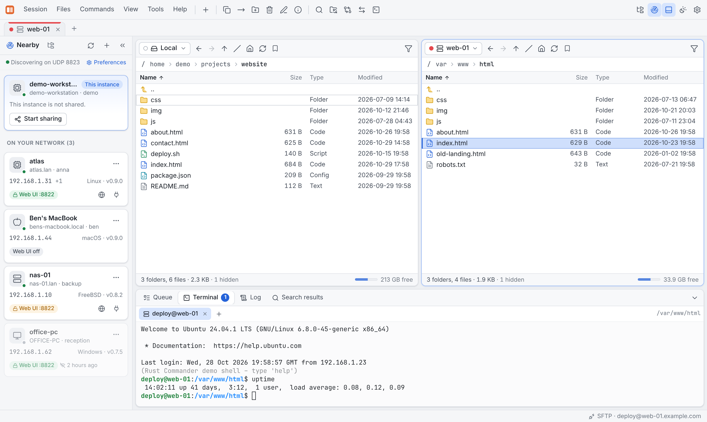
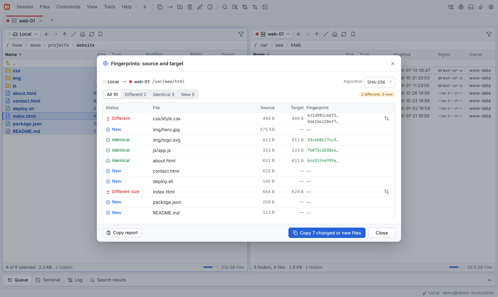
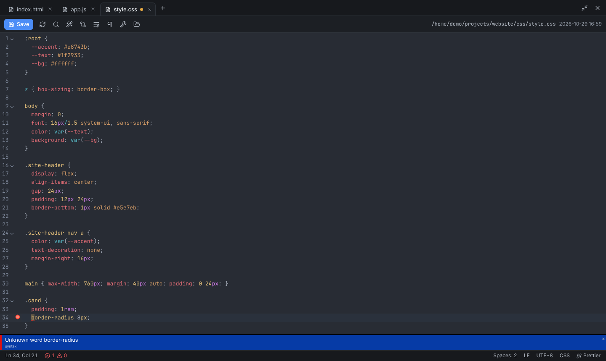
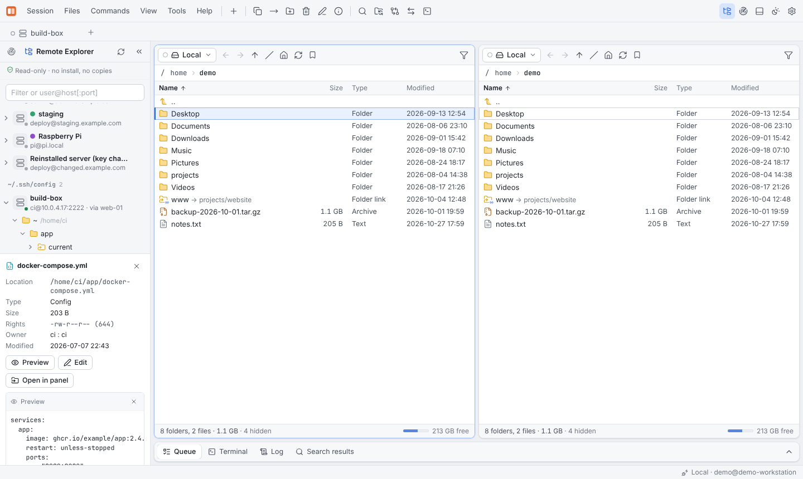
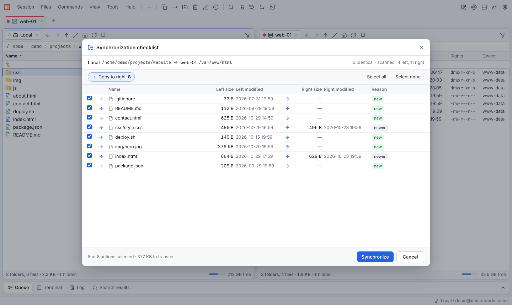
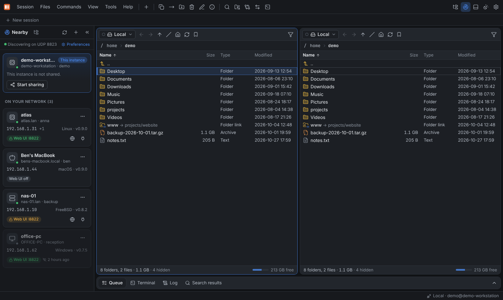
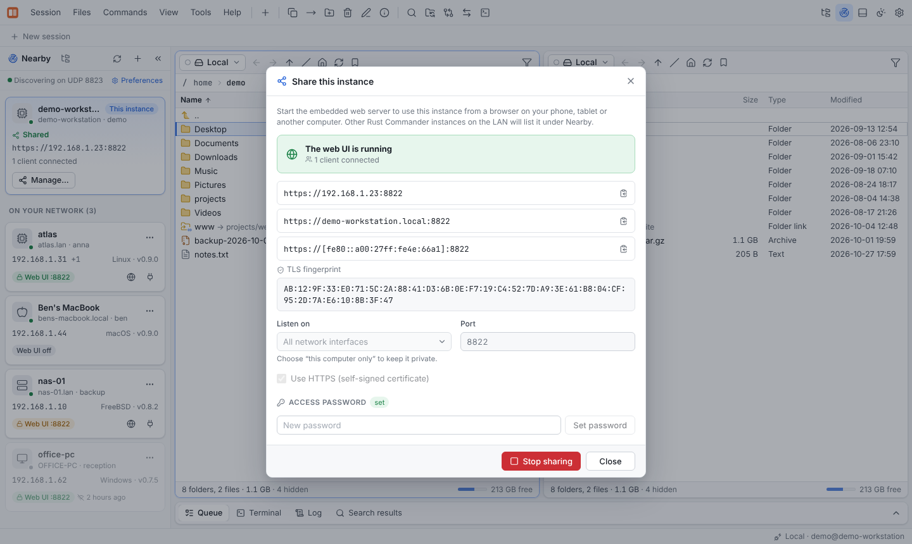

<div align="center">


# Rust Commander

**A fast two-panel file manager and transfer client — written in Rust.**<br>
SFTP · SCP · FTP/FTPS · WebDAV · S3 · Azure · Google Cloud Storage — on your desktop and in your browser.

[](https://github.com/bobnautic/rustcommander/actions/workflows/ci.yml)
[](https://github.com/bobnautic/rustcommander/releases)
[](LICENSE)


[Highlights](#-highlights) · [Screenshots](#-screenshots) · [Quick start](#-quick-start) · [Documentation](#-documentation) · [Building](#-building)

</div>

<br>

<picture>
  <source media="(prefers-color-scheme: dark)" srcset="docs/src/images/hero-dark.png">
  
</picture>

## ✨ Highlights

<table>
<tr>
<td width="50%" valign="top">

### 🗂️ Classic commander, modern feel
Two panels, session tabs, bookmarks, drag & drop and full keyboard control
(F2–F8, Ins, Ctrl+…). Light and dark theme, English and German.

</td>
<td width="50%" valign="top">

### 🌐 Every protocol in one place
SFTP, SCP, FTP/FTPS, WebDAV, S3 and compatibles (MinIO, R2, Wasabi …), Azure Blob and
GCS. Copy **server to server** — SFTP → S3 — without touching your disk.

</td>
</tr>
<tr>
<td valign="top">

### 🔍 Fingerprints before you copy
See which files are *identical*, *different* or *new* on the target — checksummed
**where the files live** (`sha256sum` over SSH, FTP `HASH`) — and copy only what changed.

</td>
<td valign="top">

### 🔄 Sync with a checklist
One- or two-way synchronization by time, size or checksum, mirror mode, and a checklist
of every action before anything runs. Or keep a remote folder up to date live.

</td>
</tr>
<tr>
<td valign="top">

### 📝 A real code editor, everywhere
Edit local and remote files with language detection, **linting** while you type,
**formatting** (Prettier, rustfmt, gofmt, ruff …) and a diff view of your changes.

</td>
<td valign="top">

### 🌲 Remote Explorer
Browse every SSH host from your saved sites and `~/.ssh/config` as a tree, with preview —
nothing is installed or copied on the target. Even works without SFTP.

</td>
</tr>
<tr>
<td valign="top">

### 🖥️ Headless web mode
`rcmd serve` runs Rust Commander on a server and serves the **full UI over HTTPS**.
Works on phones, too.

</td>
<td valign="top">

### 📡 Finds its peers on the LAN
Instances discover each other automatically. Open their web UI with one click or mount
another instance **as a file panel** with a pinned TLS certificate.

</td>
</tr>
<tr>
<td valign="top">

### 💻 Terminal & tunnels
SSH and local shells in tabs, local port forwarding (`-L`) and SOCKS5 proxies (`-D`)
through any SSH session.

</td>
<td valign="top">

### 🔐 Secure by default
Host-key verification, TLS checks, an encrypted credential vault (XChaCha20-Poly1305,
optional Argon2id master password), throttled and CSRF-protected web logins.

</td>
</tr>
</table>

## 📸 Screenshots

| Fingerprints before copying | Built-in editor with linting |
|:---:|:---:|
|  |  |
| **Remote Explorer** | **Synchronization checklist** |
|  |  |
| **Nearby instances on the LAN** | **Share this instance** |
|  |  |

## 🚀 Quick start

### Desktop

Download the latest version from the
[releases page](https://github.com/bobnautic/rustcommander/releases/latest):

| macOS (Apple silicon + Intel) | Windows 10/11 | Linux |
|:---:|:---:|:---:|
| `rustCommander-<version>-macos-universal.dmg` | `rustCommander-<version>-windows-x64-setup.exe`<br>or `…-portable.exe` | `.AppImage` · `.deb` · `.rpm` |

See [Installation](docs/src/getting-started/installation.md) for first-start notes, or
[build it](#-building) yourself. Start **Rust Commander**, press **Ctrl+N** to open the Site
Manager and connect. The keys work as in every classic commander: **F5** copy,
**F6** move, **F7** new folder, **F8** delete, **F4** edit, **F1** all shortcuts.

### On a server (web mode)

```bash
rcmd set-password        # once
rcmd serve               # → https://<host>:8822/  (self-signed certificate, fingerprint is printed)
```

Or with Docker:

```bash
docker build -t rust-commander .
docker run -d -p 8822:8822 -p 47800:47800/udp -v /srv:/data \
  -e RCMD_PASSWORD=change-me --name rcmd rust-commander
```

### Scripting

```bash
rcmd script -c "open sftp://deploy@example.com" \
            -c "synchronize remote ./dist /var/www/html -delete -criteria=checksum" \
            -c "exit"
```

## 📚 Documentation

The full documentation lives in [`docs/`](docs/) and can be built as a website with
[mdBook](https://rust-lang.github.io/mdBook/) (`mdbook serve docs`).

| Getting started | User guide | Reference |
|---|---|---|
| [Introduction](docs/src/introduction.md) | [The interface](docs/src/guide/interface.md) | [Keyboard shortcuts](docs/src/reference/keyboard-shortcuts.md) |
| [Installation](docs/src/getting-started/installation.md) | [Sites and sessions](docs/src/guide/sites-and-sessions.md) | [Command line (`rcmd`)](docs/src/reference/cli.md) |
| [Building from source](docs/src/getting-started/building.md) | [Protocols](docs/src/guide/protocols.md) | [Scripting](docs/src/reference/scripting.md) |
| [Quick tour](docs/src/getting-started/quick-tour.md) | [Transfers](docs/src/guide/transfers.md) · [Fingerprints](docs/src/guide/fingerprints.md) | [File masks](docs/src/reference/file-masks.md) |
| | [Synchronization](docs/src/guide/synchronization.md) | [Configuration files](docs/src/reference/configuration.md) |
| **Deployment** | [Editor](docs/src/guide/editor.md) · [Remote Explorer](docs/src/guide/remote-explorer.md) | **Development** |
| [Headless server](docs/src/deployment/headless-server.md) | [Terminal and SSH tunnels](docs/src/guide/terminal-and-tunnels.md) | [Architecture](docs/src/development/architecture.md) |
| [Security](docs/src/deployment/security.md) | [LAN discovery](docs/src/guide/lan-discovery.md) · [Web mode](docs/src/guide/web-mode.md) | [Testing](docs/src/development/testing.md) · [Releasing](docs/src/development/releasing.md) |

## 🛠️ Building

Requirements: Rust (stable, 1.91+), Node.js 20+, and on Linux the
[Tauri prerequisites](https://tauri.app/start/prerequisites/)
(`libwebkit2gtk-4.1-dev`, `librsvg2-dev`, `libayatana-appindicator3-dev`, `libxdo-dev`).

```bash
npm --prefix ui ci && npm --prefix ui run build   # user interface
npm ci && npm run build                           # desktop app → src-tauri/target/release/bundle/
cargo build --release -p rc-cli                   # headless server + CLI → target/release/rcmd
```

Try the UI without any backend: `npm --prefix ui run dev`, then open
`http://localhost:5173/?mock=1`.

```bash
cargo test --workspace     # Rust tests
npm --prefix ui test       # UI unit tests + Playwright smoke test
```

### Architecture at a glance

```
crates/rc-core        Vfs abstraction + all protocols, transfer queue, sync, search, vault, tunnels, archives
crates/rc-discovery   LAN discovery via UDP broadcast and multicast
crates/rc-api         application state + RPC dispatcher (one API for desktop and web)
crates/rc-server      HTTP(S) server: embedded UI, /api/rpc, WebSocket events, upload/download
crates/rc-cli         rcmd: serve, discover, script, set-password, sites
src-tauri/            desktop app (Tauri 2)
ui/                   React + TypeScript + Vite, identical for desktop and web
```

More in [Architecture](docs/src/development/architecture.md) and
[Known limitations](docs/src/limitations.md).

## 📄 License

MIT — see [LICENSE](LICENSE).
