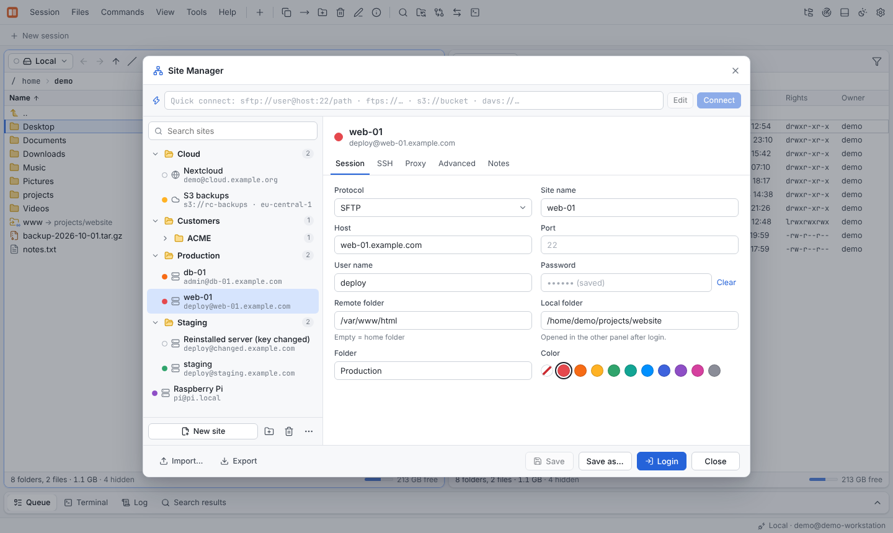
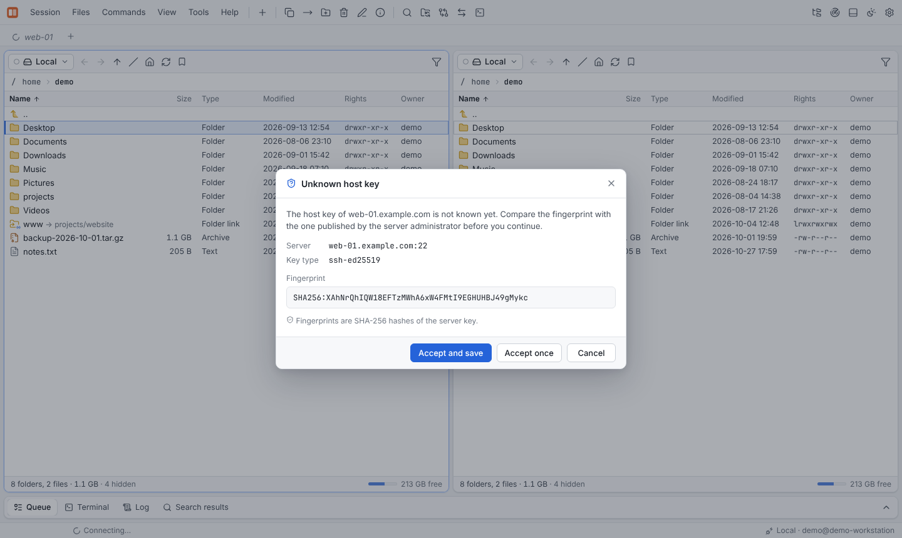
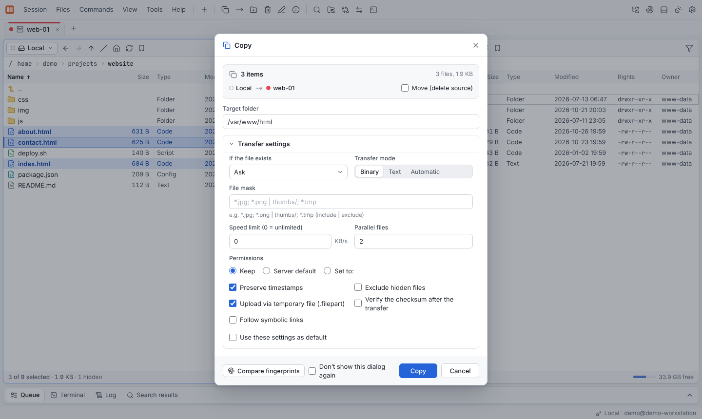

# Quick tour

This tour takes five minutes and covers the things you will use every day.

## 1. Start the app

Start `rust-commander`. Both panels show your local file system; the left panel is active
(highlighted border). **Tab** switches between the panels.

## 2. Connect to a server

Press **Ctrl+N** to open the **Site Manager**. Pick a saved site or create one, then click
**Login**. You can also type a URL such as `sftp://deploy@web-01.example.com/var/www/html`.

The first time you connect to an SSH server, Rust Commander shows the server's host key
fingerprint and asks whether you trust it. Compare it with the fingerprint the server
administrator gave you, then choose to accept it once or permanently.

The connection opens in a **session tab** and in the right panel. If the site has a local
folder configured, the left panel jumps there.

## 3. Copy files

Select files with **Insert**, **Space**, **Ctrl+click** or **+** (select by mask), then press
**F5**. The copy dialog shows the target and the transfer options; **F6** moves instead.
You can also drag files from one panel to the other (hold **Shift** to move).

Transfers run in the background. The **Queue** tab at the bottom shows their progress and
lets you pause, resume, cancel or retry them.

## 4. Check before you overwrite

Not sure what is already on the server? Press **Ctrl+K** to compare the fingerprints of the
selection with the folder in the other panel. Every file is marked *identical*,
*different*, *different size* or *new*, and one click copies only what changed.
See [Fingerprints before copying](../guide/fingerprints.md).

## 5. Edit a file in place

Press **F4** on any file — local, on an SFTP server, in an S3 bucket — to open it in the
built-in [editor](../guide/editor.md). **Ctrl+S** saves it back to where it came from.

## 6. Open a terminal

**Ctrl+T** opens a shell in the current folder of the active panel: an SSH shell for SSH
sessions, a local shell for the local file system.

## 7. Explore

- **Ctrl+Shift+E** opens the [Remote Explorer](../guide/remote-explorer.md) for all your SSH targets.
- **Ctrl+B** shows the sidebar with **Nearby** instances on your network.
- **Ctrl+Shift+S** opens [Synchronization](../guide/synchronization.md).
- **F1** lists every keyboard shortcut.
