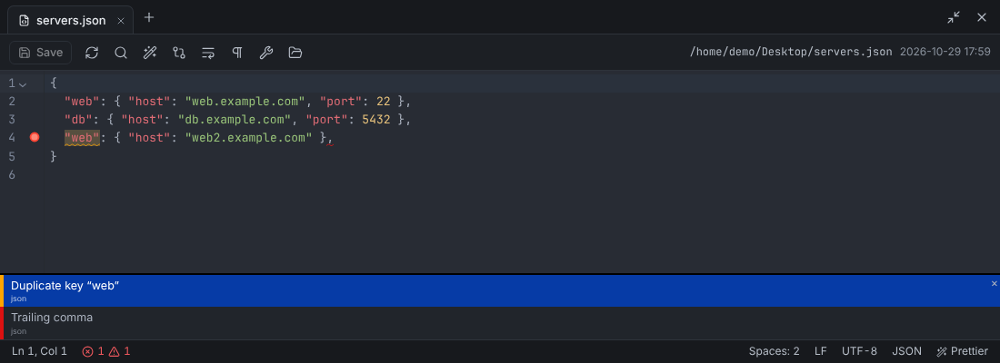
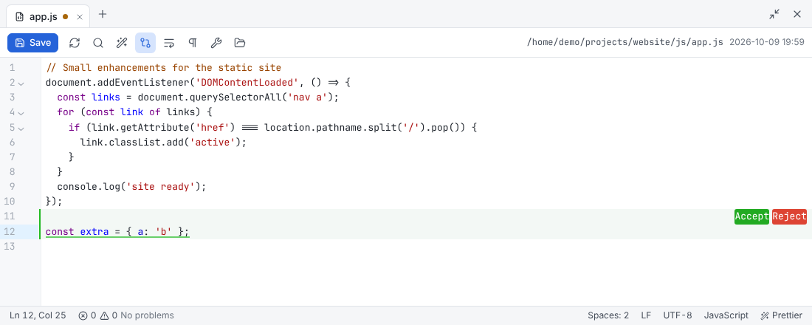

# Editor

Rust Commander has a built-in code editor for files **wherever they are**: on the local
disk, on an SFTP/SCP/FTP server, in a bucket or on another Rust Commander instance.
Saving writes the file straight back to its origin.

## Opening files

- **F4** edits the focused file, **F3** opens it read-only.
- **Ctrl+P** (*Files* → **Open file…**) opens any path in any connected session, with
  **Tab** completion and a list of recently opened files. Files that don't exist yet can be
  created.
- Each file opens in an editor tab; tabs keep their undo history and cursor position.
- **Show in file panel** jumps to the file in a panel; **Back to the file panels** hides
  the editor without closing it (the status bar shows the number of open files).
- Binary files are shown as hex; very large files are truncated.

## Language detection

The language is detected from the **file name** — including names such as
`Dockerfile.prod`, `.bashrc`, `*.service` or `nginx/sites-available/*` — and otherwise from
the **content**: shebang lines, `vim: ft=` modelines and XML/HTML/JSON/YAML headers.

Click the language in the status bar to change it. The choice is remembered for all files
with the same extension.

## Linting

Problems are found while you type:

- **Syntax errors** with line and column for JavaScript/TypeScript/CSS (via the Prettier
  parsers), YAML, TOML, JSON, XML, HTML, Python, Rust, Go and Java
- **Duplicate keys** in JSON and YAML
- **Merge conflict markers**
- **Mixed indentation** and **invisible characters**

Problems are marked in the gutter and counted in the status bar. **Ctrl+Shift+M** lists
them, **F8** jumps to the next one.

## Formatting

**Shift+Alt+F** formats the document; **Format when saving** (in **Preferences** →
**Editor**) does it automatically.

| Languages | Formatter |
|---|---|
| JavaScript, TypeScript, JSON, CSS/SCSS/Less, HTML, Vue, Markdown, YAML | Prettier (built in) — keeps the file's indentation, quote style and semicolons |
| SQL (several dialects), XML | Built in |
| Rust | `rustfmt` |
| Go | `gofmt` |
| Python | `ruff` or `black` |
| Shell | `shfmt` |
| C, C++, Java | `clang-format` |
| TOML | `taplo` |
| Lua | `stylua` |

External formatters are used when they are installed on the machine Rust Commander runs
on (for the web mode: the server). The status bar shows which formatter is active.

## Seeing changes

- **Show changes since saving** marks changed lines; each change can be accepted or
  reverted individually.
- If someone changed the file on the server since you opened it, saving asks before
  overwriting and offers a comparison.
- **Compare…** compares the file with the **saved version** or with the **file of the
  same name in the other panel**.

## Status bar

Line and column, number of cursors and selected characters, problems, **indentation**
(detected; switch or convert between spaces and tabs), **line endings** (LF/CRLF are
preserved), **encoding** (UTF-8, UTF-8 with BOM, Latin-1), language and formatter.

## Tools

The editor toolbar and its **Tools** menu offer:

- Go to line (**Ctrl+G**), find/replace, toggle comment (**Ctrl+/**)
- Sort lines (ascending/descending), remove duplicate lines, UPPERCASE / lowercase
- Remove trailing whitespace, re-indent leading whitespace
- Sort JSON keys, minify JSON
- Show whitespace, word wrap, text size (**Ctrl+=** / **Ctrl+-**)

## External applications

In the desktop app, **Edit with external application** (context menu of a remote file, or
the button in the editor toolbar) downloads the file to a temporary folder and opens it in
the default program for its type. Every time you save there, Rust Commander uploads the
file automatically.
