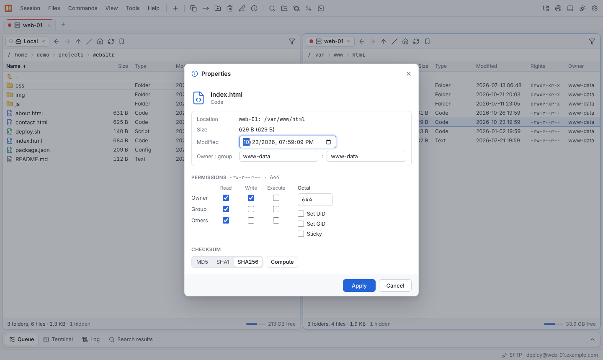

# File operations

All operations work the same on every protocol, as far as the protocol allows (object
stores, for example, have no permissions or symlinks).

| Key | Operation |
|---|---|
| Enter | Open folder / file |
| F2 | Rename in place |
| F3 / F4 | View / [edit](editor.md) |
| Shift+F4 | New file |
| F5 / F6 | [Copy / move](transfers.md) to the other panel |
| Shift+F5 / Shift+F6 | Copy / move without the dialog |
| F7 | New folder |
| F8, Delete | Delete (recursive deletes run as a background job); local files go to the trash |
| Shift+F8, Shift+Delete | Delete permanently (local files skip the trash) |
| Ctrl+Z | Undo the last rename or move |
| Alt+Enter | Properties |
| Ctrl+Shift+C | Copy the full path(s) to the clipboard |

*Files* → **Create link…** creates a symbolic link.

## Trash and undo

In the desktop app, **F8** moves *local* files and folders to the system trash (the
freedesktop trash on Linux, the Finder trash on macOS, the recycle bin on Windows), so a
wrong delete can be restored from there. **Shift+Delete** deletes for good. The
confirmation dialog says which of the two will happen. *Preferences* → *General* →
**Move deleted local files to the trash** switches the trash off. Remote files and the
files of a [headless server](../deployment/headless-server.md) are always deleted
directly: servers have no trash.

**Ctrl+Z** (*Files* → **Undo**) reverts the last **rename** or the last **move** within one
session. A move is undoable once its job has completed; items that were changed or moved
again in the meantime are left alone.

## Faster operations on SSH servers

On SFTP and SCP sessions, recursive operations run as a single shell command on the server
instead of one request per file: deleting a folder (`rm -rf`), changing permissions or the
owner recursively (`find … -exec chmod/chown`), folder sizes (`find | awk`) and the
[search](#find-files) (`find` lists the tree, `grep -l` searches contents, nothing is
downloaded). Rust Commander first checks that the shell sees the same files as SFTP (its
home directory matches) and that GNU find is installed; otherwise, and whenever a command
fails, it falls back to the normal way, which also reports each failing file.

## Properties



**Alt+Enter** opens the properties of the selection:

- **Permissions** as checkboxes or octal, optionally **recursive**, with separate rights
  for folders and files
- **Owner and group** (`chown`)
- **Modification date**
- **Folder size** with the number of files and folders (calculated on demand)

## Checksums

*Files* → **Compute checksum…** calculates MD5, SHA-1 or SHA-256. Where possible it runs
on the server (see [Fingerprints](fingerprints.md)).

## Find files

**Ctrl+F** searches the current folder of the active panel by **name**, **size**, **date**
and **content**. Results appear in the **Search results** tab of the dock; from there you
can reveal a file in its panel, view or edit it, or copy its path.

## Compare

- **Ctrl+K** — [compare fingerprints](fingerprints.md) of the selection with the other
  panel.
- *Commands* → **Compare with other panel** — show a text diff between the focused file
  and the file with the same name in the other panel.

## Archives

*Commands* → **Archive** creates ZIP, TAR and TAR.GZ archives and extracts them
(**Extract here**). Archive operations work on the local file system.

## Custom commands

*Tools* → **Custom commands…** defines your own commands, which then appear under
*Commands* → **Custom commands**. A command can run on the server of the session or
locally, once per file or once for the whole selection, show its output and refresh the
panel afterwards.

Placeholders:

| Pattern | Replaced with |
|---|---|
| `!` | The file name |
| `!&` | All selected names |
| `!/` | The current folder |
| `!@` | The host |
| `!U` | The user name |
| `!!` | A literal `!` |

The built-in commands show how it works:

```text
tail -n 200 "!"      Tail (last 200 lines)
du -sh !&            Disk usage
sha256sum !&         SHA-256 checksums
tar -xf "!"          Extract archive here
```
