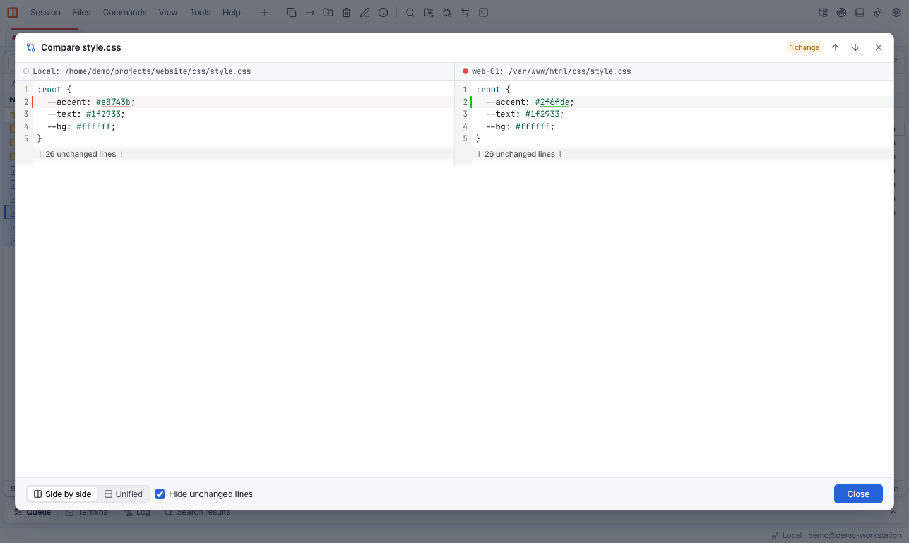

# Fingerprints before copying

Before you overwrite anything on a server, Rust Commander can tell you **exactly what the
copy would change** — file by file, by content, without downloading the files where the
protocol allows it.

## Starting a comparison

- In the **copy dialog** (F5) click **Compare fingerprints**, or
- select files and press **Ctrl+K** (or *Commands* → **Compare fingerprints with other
  panel…**, also in the context menu) to compare the selection with the folder in the
  other panel.

Folders are compared recursively.

## Result

Each file gets a status:

| Status | Meaning |
|---|---|
| **Identical** | Same content on both sides |
| **Different** | Same size, but the checksums differ |
| **Different size** | Sizes differ — no checksum needed |
| **New** | Does not exist on the target yet |

Filter the list by status with the tabs above it, and pick the algorithm (**SHA-256**,
**SHA-1** or **MD5**) in the top right corner.

- **Copy N changed or new files** starts the transfer with the overwrite mode *Overwrite
  if the content differs*. Every existing file is compared again while copying, so only
  files with different content are overwritten — even if something changed since the
  comparison.
- The diff button next to a changed text file shows the differences.
- **Copy report** puts the list with all checksums on the clipboard.

## Where the checksums are calculated

Rust Commander calculates checksums **where the files are**, whenever the protocol allows
it:

| Location | How |
|---|---|
| Local disk | Directly |
| SFTP / SCP | `sha256sum`, `sha1sum` or `md5sum` over SSH (`shasum`/`md5` on BSD and macOS) |
| FTP | The `HASH` command, if the server supports it |
| Another Rust Commander instance | The instance calculates it itself |
| Anything else | The file is read to calculate the checksum |

Files of different size never need a checksum.

## Also in the conflict dialog

When a transfer asks **File already exists**, the dialog can compare the two fingerprints
as well and show the differences before you decide.
