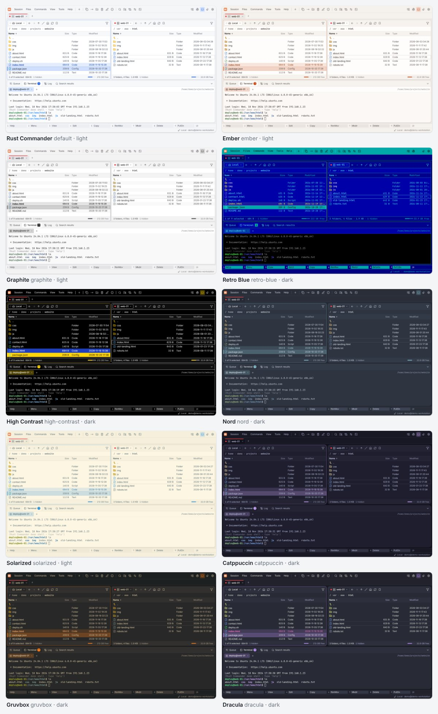
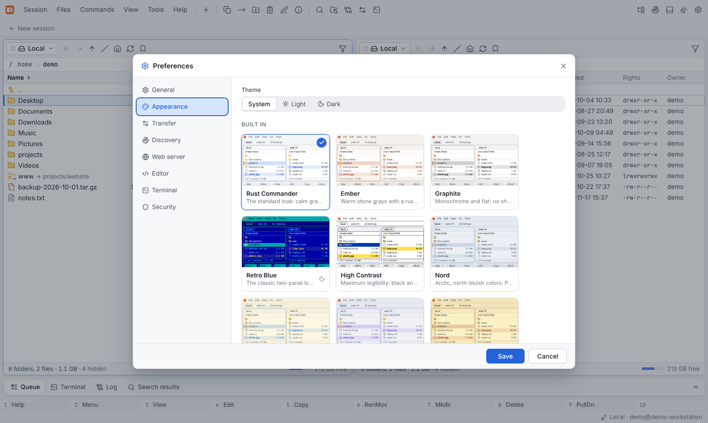
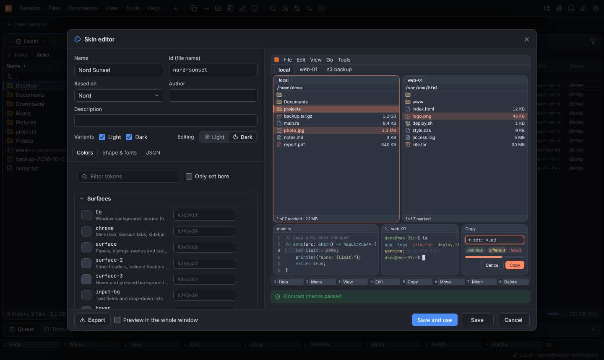

# Skins and appearance

A **skin** decides how Rust Commander looks: the colors of every surface, the file icons,
the terminal and the editor's syntax highlighting, plus fonts, corner radius and row height.
Ten skins come with the app, you can adjust any of them to your taste, and you can create
your own — in the built-in skin editor or as a small JSON file
(see [Creating skins](creating-skins.md)).

## Choosing a skin

*View* → **Skin** lists all skins; a click switches immediately. For a visual overview open
*View* → *Skin* → **Appearance…** (or **Preferences**, Ctrl+, → **Appearance**):

- **Theme** picks the variant: *System* follows the light/dark setting of your operating
  system (or browser), *Light* and *Dark* force one. The toolbar button cycles through the
  three.
- **Built in** and **Your skins** show a live miniature of every skin in the current variant.
  Clicking one previews it in the whole window; **Save** keeps it, **Cancel** goes back.
- A sun or moon icon on a card marks a skin that has only a light or only a dark variant
  (*Retro Blue* and *Dracula* are always dark).

The skin is stored in `settings.json` with the other preferences. In [web mode](web-mode.md)
the server stores it, so every browser that opens the instance shows the same skin.

### The built-in skins

| Skin | Variants | Character |
|---|---|---|
| **Rust Commander** | light + dark | The standard look: calm grays with a blue accent. |
| **Ember** | light + dark | Warm stone grays and a rust-orange accent, slightly rounder. |
| **Graphite** | light + dark | Monochrome and flat: no shadows, small corners, compact striped lists. |
| **Retro Blue** | dark | The classic two-panel look of the DOS days: blue panels, cyan text, a cyan cursor bar, yellow marked files, square corners and a monospaced font. |
| **High Contrast** | light + dark | Black and white, solid borders, strong selection colors and larger list text. |
| **Nord** | light + dark | Arctic, north-bluish colors (palette by Arctic Ice Studio). |
| **Solarized** | light + dark | Ethan Schoonover's low-glare palette. |
| **Catppuccin** | light + dark | Soothing pastels: *Latte* when light, *Mocha* when dark. |
| **Gruvbox** | light + dark | Retro groove: earthy, warm colors with an orange accent. |
| **Dracula** | dark | Vivid purple, pink and green on a dark background. |

Every built-in skin colors the terminal and the editor as well, and is checked for readable
contrast (text on panels, marked files, the cursor row, buttons, terminal text).

## Adjustments

Below the gallery, **Adjustments** change the look *on top of* whatever skin is selected —
switch skins and your adjustments stay:

| Adjustment | Effect |
|---|---|
| **Accent color** | Buttons, links, the active panel, the cursor and selection colors. Hover and selection shades are derived from it automatically. |
| **Row height** | *Compact*, *Normal* or *Comfortable* rows in the file lists. |
| **List font size** | Font size of the file lists (11–18 px); the row height follows. |
| **Corner radius** | From square (0 px) to round; panels and dialogs scale along. |
| **Striped rows** | Alternating row backgrounds in the file lists. |
| **Interface font** / **Monospaced font** | Any font installed on your computer, as a CSS font list, e.g. `Inter, sans-serif` or `'JetBrains Mono', monospace`. |

*From skin* (or an empty field) means the skin decides; **Reset adjustments** clears them all.

## Your own skins

There are three ways to get a skin of your own:

1. **Customize a built-in skin.** Hover over its card and click the copy icon
   (**Customize (copy)**). The skin editor opens with a new skin that is *based on* the
   built-in one — change only what you want, everything else is inherited.
2. **New skin** (above *Your skins*) does the same for the selected skin.
3. **Import…** a skin file someone shared (`*.json`), or drop skin files into the
   [skins folder](#the-skins-folder).

User skins appear under **Your skins**. Hover over a card to **edit**, **export** (download
the file to share it) or **delete** it.

### The skin editor

- **Name**, **Id** (also the file name), **Author** and **Description**; **Based on** chooses
  the skin it inherits from.
- **Variants**: whether the skin has its own light and/or dark colors. **Editing** switches
  between them.
- **Colors** lists every token by group (surfaces, text, accent, selection, status, palette,
  file icons, menu and key bar, terminal, syntax, editor). Click a swatch to pick a color or
  type any CSS color (`#0af`, `rgba(0, 170, 255, 0.3)`, `hsl(200 100% 50%)`). Empty fields
  show the inherited value in gray; the reset button removes your value again.
  *Only set here* shows just what your skin changes.
- **Shape & fonts**: fonts, corner radii, row height, list font size, striped rows.
- **JSON** shows the skin file; you can edit it there or copy it.
- The **preview** on the right shows panels, marked files, the cursor, the editor, the
  terminal and controls in the skin; **Preview in the whole window** applies it to the
  entire app while you edit.
- The **contrast check** below the preview warns when text would be hard to read.

**Save** stores the skin in the skins folder, **Save and use** also selects it.

### The skins folder

User skins are plain JSON files in the `skins` folder of the
[configuration directory](../reference/configuration.md#configuration-directory), for example
`~/.config/rust-commander/skins/` on Linux. Preferences → Appearance shows the exact path; in
the desktop app **Open folder** opens it.

- Every `*.json` file there is loaded. Files that cannot be used are listed under
  *Skin files with problems* with the reason.
- Changes to the files show up as soon as you switch back to the Rust Commander window (or
  click **Reload skins**) — handy while [writing a skin](creating-skins.md) in your favorite
  editor.
- The ids of built-in skins are reserved; a user skin cannot replace *Nord* itself, but it can
  be based on it.

## Troubleshooting

- **A skin does not appear.** Check *Skin files with problems* in Preferences → Appearance.
  The file must be valid JSON with an `id` (a–z, 0–9, `-`, `_`) and a `name`.
- **A color is ignored.** Values that are not colors (or for shadows: not a box-shadow) are
  skipped; the skin editor and **Import** report them. See the
  [token reference](../reference/skin-tokens.md) for the names.
- **Everything looks wrong after an experiment.** *View* → *Skin* → **Rust Commander** and
  **Reset adjustments** bring back the standard look.
