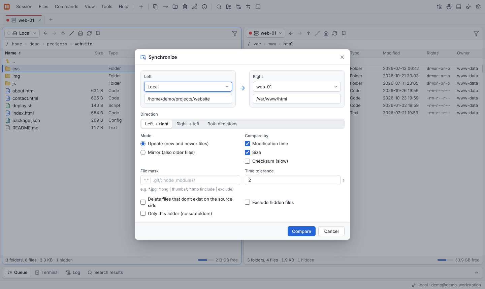

# Synchronization

Synchronization compares the folders of the two panels and brings them in line. Nothing
is changed until you have reviewed the **checklist**.

## Synchronize

Press **Ctrl+Shift+S** (or *Commands* → **Synchronize**). The dialog is pre-filled with
the sessions and folders of both panels; you can pick any two sessions, so remote-to-remote
synchronization works too.



| Option | Choices |
|---|---|
| **Direction** | *Left → right*, *Right → left* or *Both directions* |
| **Mode** | *Update* (new and newer files) or *Mirror* (also older files — the target follows the source even where the target is newer) |
| **Compare by** | Any combination of *Modification time*, *Size* and *Checksum (slow)* |
| **Time tolerance** | Seconds by which modification times may differ and still count as equal |
| **File mask** | Include and exclude files, e.g. `* \| .git/; node_modules/` — see [File masks](../reference/file-masks.md) |
| **Delete files that don't exist on the source side** | Remove obsolete files on the target |
| **Only this folder** | Do not descend into subfolders |
| **Exclude hidden files** | Skip dot files |

## The checklist

**Compare** scans both sides and shows every planned action with its reason:


- Actions are grouped as *Copy to right*, *Copy to left*, *Delete left*, *Delete right* and
  *Conflicts* (changed on both sides).
- Reasons: *new*, *newer*, *older*, *size differs*, *content differs*, *obsolete*,
  *changed on both sides*.
- Untick anything you don't want; **Select all** / **Select none** help with long lists.
  The footer shows how many actions are selected and how much data will be transferred.
- **Synchronize** queues the selected actions as one job in the [queue](transfers.md#the-queue).

If both sides are already in sync, the dialog says so and nothing is queued.

## Keep remote folder up to date

*Commands* → **Keep remote folder up to date** watches a local folder and uploads every
change to a remote folder as it happens — handy while developing a website or a
configuration.

- Pick the **local folder**, the **remote session** and the **remote folder**.
- **Synchronize once before watching** brings the remote folder up to date first.
- **Delete remote files when they are deleted locally** mirrors deletions.
- **Active watches** lists running watches; **Stop** ends one.

## From the command line

The same engine is available in [scripts](../reference/scripting.md):

```text
synchronize remote ./dist /var/www/html -delete -criteria=checksum
keepuptodate ./site /var/www/html -delete
```
