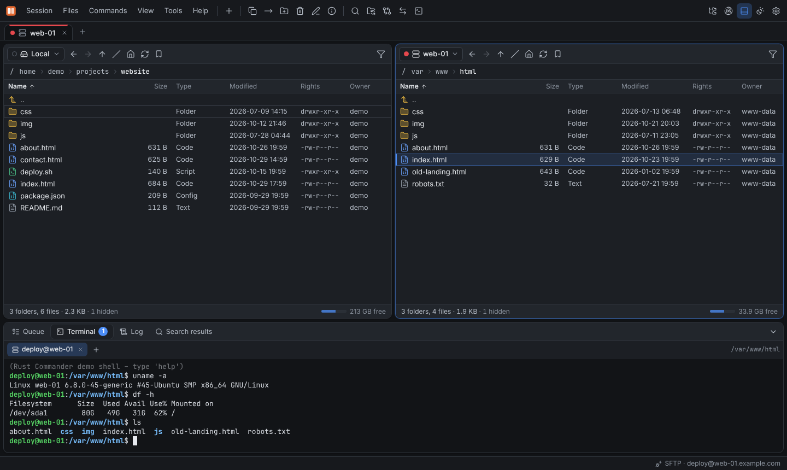

# Terminal and SSH tunnels

## Terminal

**Ctrl+T** (or *Commands* → **Open terminal**) opens a shell in the **Terminal** tab of the
dock, in the current folder of the active panel:

- an **SSH shell** for SFTP and SCP sessions,
- a **local shell** for the local file system,
- a shell on **another Rust Commander instance** that is connected as a panel.

Every shell gets its own tab; **+** opens another one. The terminal is a full xterm.js
terminal with colors and resizing. Font family, font size and scrollback lines can be set
under **Preferences** → **Terminal**.

In the [web mode](web-mode.md) terminals run on the server. `rcmd serve --no-terminal` or
**Preferences** → **Allow terminal access through the web UI** turns them off for web
users.

## Commands on the server

[Custom commands](file-operations.md#custom-commands) run on the server of the panel's
session (or locally) with placeholders for the selected files, and can show their output.
In [scripts](../reference/scripting.md), `call <command>` does the same.

## SSH tunnels

*Session* → **SSH tunnels** forwards ports through an open SSH session (SFTP or SCP):

| Type | Equivalent | What it does |
|---|---|---|
| **Local forward** | `ssh -L` | Connections to the listen address on this computer are forwarded to a target host and port **as seen from the SSH server** — for example a database that only listens on the server's `localhost` |
| **Dynamic (SOCKS5)** | `ssh -D` | Applications that use the SOCKS5 proxy on the listen address are routed through the SSH server |

Pick the **SSH session**, the **listen address** and **port**, and for a local forward the
**target host** and **port**, then **Start tunnel**. **Active tunnels** shows each tunnel
with its number of connections and the traffic in both directions; **Stop** ends it.
