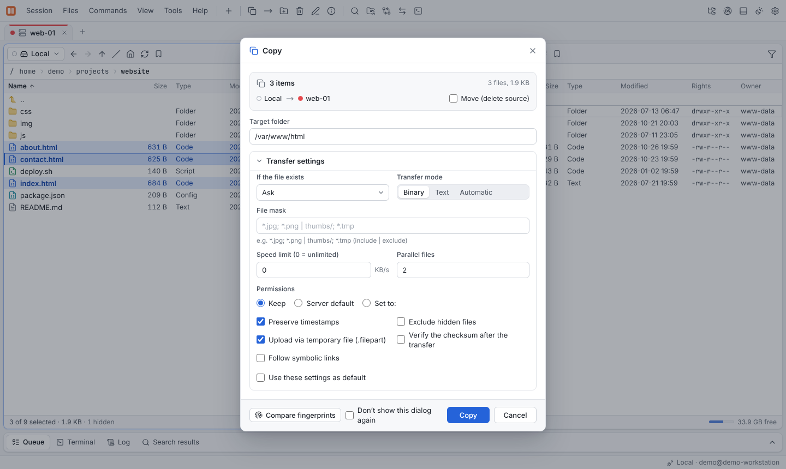
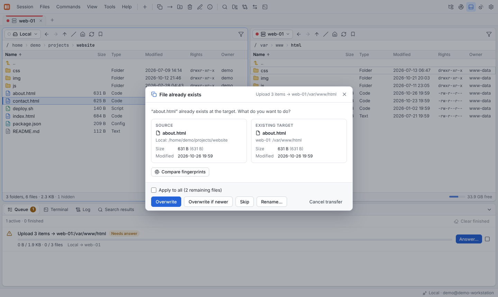

# Transfers

## Copy and move

Select files and press **F5** to copy or **F6** to move them to the folder of the other
panel. You can also drag them (hold **Shift** to move) onto the other panel, a folder or a
session tab. **Shift+F5** / **Shift+F6** skip the dialog.

The dialog shows the target folder (editable) and, under **Transfer settings**, the
options for this transfer:

| Option | Meaning |
|---|---|
| **If the file exists** | What to do with existing files (see below) |
| **Transfer mode** | *Automatic*, *Binary* or *Text* (line endings are converted for files matching the **text file masks**) |
| **File mask** | Which files to include and exclude, e.g. `*.jpg; *.png \| thumbs/; *.tmp` — see [File masks](../reference/file-masks.md) |
| **Exclude hidden files** | Skip dot files |
| **Follow symbolic links** | Copy the link target instead of the link |
| **Preserve timestamps** | Keep the modification time |
| **Permissions** | *Keep*, *Server default* or *Set to* a mode such as `644` |
| **Speed limit** | KB/s, 0 = unlimited |
| **Parallel files** | How many files of one job are transferred at the same time |
| **Upload via temporary file** | Upload as `.filepart` and rename when complete, so nobody sees half-written files |
| **Verify the checksum after the transfer** | Compare source and target checksums after each file |

**Compare fingerprints** in the copy dialog checks what the copy would hit before it starts —
see [Fingerprints before copying](fingerprints.md).

Copies work between **any two sessions**: SFTP → S3, FTP → SFTP, local → another
Rust Commander instance. Data is streamed between the two sessions, not stored on your
local disk first.

## When the file already exists

| Mode | Behavior |
|---|---|
| Ask | Show a dialog for each conflict |
| Overwrite | Always overwrite |
| Skip | Keep the existing file |
| Overwrite if newer | Only if the source is newer |
| Overwrite if the size differs | Only if the sizes differ |
| Overwrite if the content differs (checksum) | Compares checksums and only overwrites files whose content differs |
| Resume | Continue an interrupted transfer |
| Keep both (rename new file) | Store the new file under a different name |

With **Ask**, the conflict dialog shows source and target side by side. It can compare
both fingerprints right there and show a diff of text files. **Apply to all** uses the
answer for the remaining files of the job.

## The queue

Every copy, move, delete and synchronization runs as a **job** in the background. The
**Queue** tab in the dock shows progress, speed, remaining time and errors per job.

- **Pause**, **Resume**, **Cancel** and **Retry** per job; **Pause all**, **Resume all**
  and **Cancel all** in the toolbar; **Clear finished** tidies up.
- **Retry only what failed** runs a failed or cancelled job again but skips every file it
  already finished.
- The **speed limit** of a running job can be changed (gauge button, KiB/s, 0 = unlimited).
- While the queue is hidden, the status bar shows the overall progress.
- Interrupted transfers can be resumed where the protocol allows it (all except uploads to
  object storage).
- Dropped connections are re-established automatically and the operation is retried.

### After a restart or a crash

Unfinished jobs are saved continuously (`jobs.json`) together with the files they have
already finished. When Rust Commander starts again, they are back in the queue with their
ids: finished files are skipped, a file that was being written is continued where it
stopped, the rest is done as planned. Jobs that were running continue by themselves
(*Preferences* → *Transfer* → **Continue interrupted transfers after a restart**; without
it they come back paused); paused jobs stay paused.

The connections that were open are connected again under the same session ids
(**Reconnect the sessions that were open when the app was closed**), so the panels and
tabs show them again. Saved sites use their stored credentials; ad-hoc connections ask
for the password again, because passwords of unsaved connections are never written to
disk. When the vault is locked, the reconnect waits until it is unlocked. A session you
close yourself is not opened again.

### Checksums on object storage

S3, Azure Blob Storage and Google Cloud Storage keep an MD5 checksum of most objects in
their metadata (the ETag of single-part S3 uploads, `Content-MD5`, `md5Hash`). Fingerprint
comparisons, *Overwrite if the content differs*, *verify after transfer* and
synchronizations by checksum use it instead of downloading the object; when one side is
an object store, both sides are compared by MD5. A mismatch found this way after a
transfer is double-checked with SHA-256 by reading both files, because an S3 ETag is not
an MD5 for some objects (SSE-KMS, SSE-C).

Uploads to object storage keep the **modification time** of the source in the user
metadata `mtime` (the same key rclone uses). Rust Commander shows and compares that time
instead of the upload time, so synchronizations by time work with buckets too.

## Web mode: browser uploads and downloads

In the [web mode](web-mode.md) there are extra commands for the computer running the
browser: **Upload from this computer…** (Ctrl+U), **Upload folder…** and **Download to
this computer**.
Folders are downloaded as a ZIP stream.
