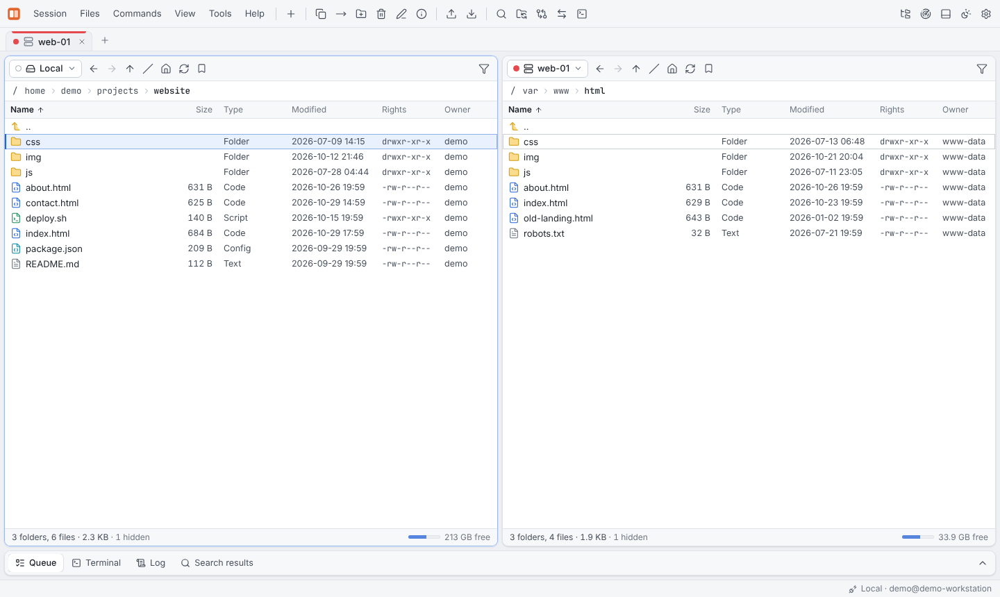
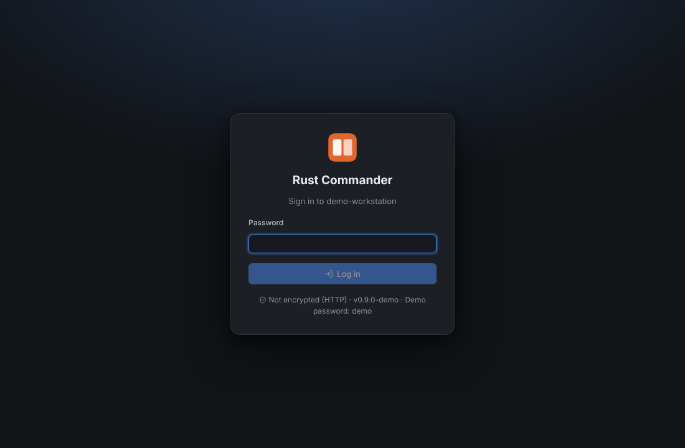
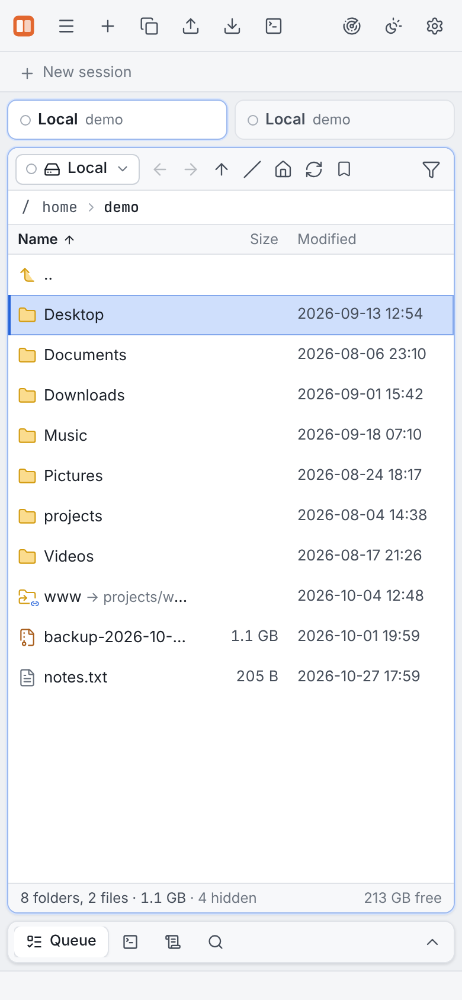

# Web mode

`rcmd serve` runs Rust Commander **without a GUI** on a host. Open
`https://<host>:8822/` in a browser on any other machine and you get the complete
interface — working on the file system of that host.



From there you can connect to further servers, too: the host becomes your jump-off point,
and transfers between it and other servers never pass through your own machine.

## Starting the server

```bash
rcmd set-password                 # store a login password once
rcmd serve                        # https://<host>:8822/ with a self-signed certificate
```

On start, `rcmd serve` prints the URLs, the **SHA-256 fingerprint of its TLS certificate**
and — if no password is stored — a generated **one-time password** for this run:

```text
  Rust Commander 0.1.0 — "web-01"

    https://192.168.1.20:8822/
    https://web-01.local:8822/

  TLS certificate (self-signed) SHA-256:
    AB:12:9F:…:47

  Login password for this session: …
  (store a permanent one with `rcmd set-password`)

  Announcing on the LAN (UDP 47800).
```

Compare the fingerprint with the one your browser shows on the first visit. All options
are listed in the [CLI reference](../reference/cli.md#rcmd-serve); for permanent setups
see [Headless server](../deployment/headless-server.md).

## Logging in



The login page shows whether the connection is encrypted. Sessions use HttpOnly and
SameSite cookies, write requests are protected against CSRF, and failed logins are
throttled. *Session* → **Log out** ends the session.

## Uploading and downloading

In the browser the toolbar and *Files* menu have extra commands for the computer the
browser runs on:

| Command | |
|---|---|
| **Upload from this computer…** (Ctrl+U) | Upload files into the active panel's folder |
| **Upload folder…** | Upload a whole folder |
| **Download to this computer** | Download the selection; folders are streamed as a ZIP |

You can also drag files from your computer's file manager onto a panel to upload them.
Uploads and downloads go directly between the browser and the host.

## On a phone or tablet

On narrow screens the interface shows one panel at a time with a switcher, a compact
toolbar and touch-friendly rows.



## Differences to the desktop app

The web mode has the same features as the desktop app, except **Edit with external
application**, which needs a local desktop. Keep in mind that everything runs on the host:
[SSH tunnels](terminal-and-tunnels.md#ssh-tunnels) listen on the host, not on the machine
running the browser, and terminals open shells there.

The Remote Explorer and the editor's external formatters use the configuration and tools
of the user that runs `rcmd serve`.
